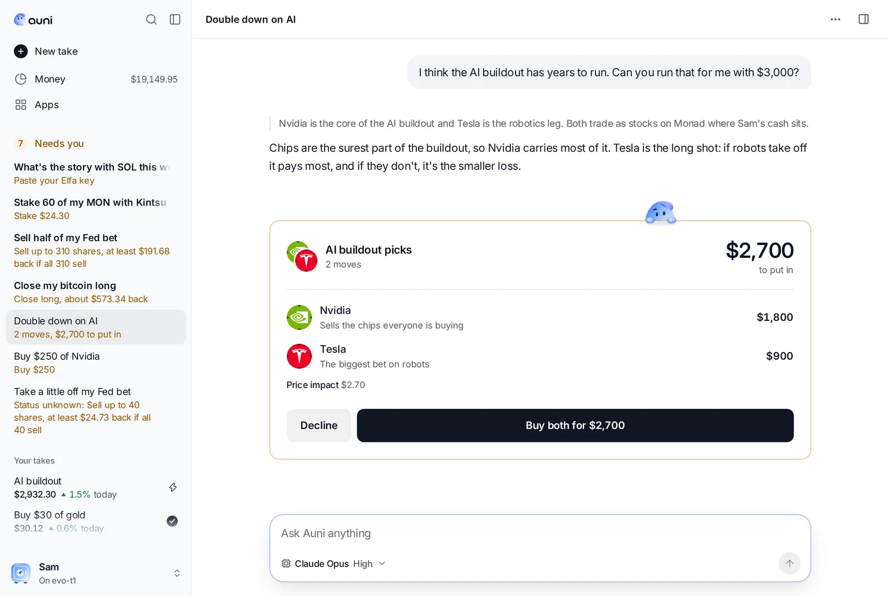
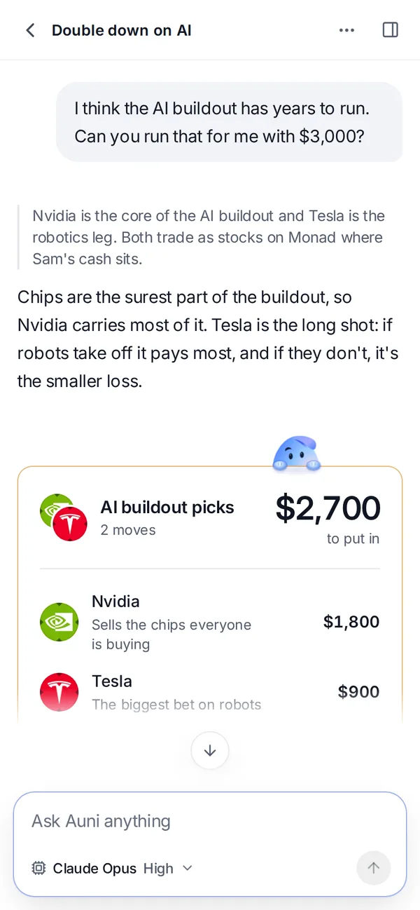
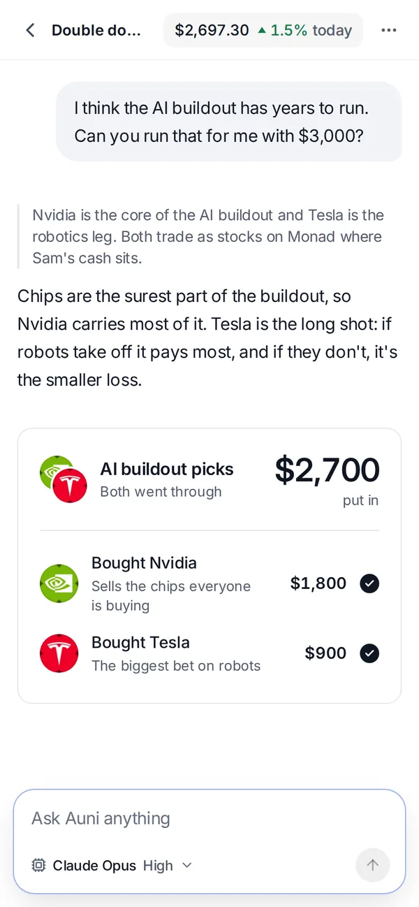
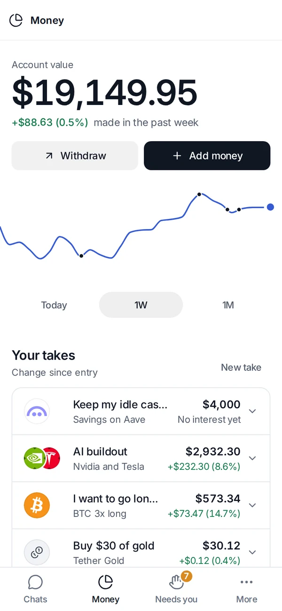

<p align="center">
  <picture>
    <source media="(prefers-color-scheme: dark)" srcset="docs/brand/lockup-dark.png">
    
  </picture>
</p>

<p align="center">
  <b>An AI agent for your own money, running on your own computer.</b><br>
  Tell it a take. It researches it and builds the position. Nothing moves until you tap,<br>
  unless you turn on Auto for a take, with a budget you set.
</p>

<p align="center">
  <a href="#try-it"><b>Try it with fake money</b></a>
</p>

<p align="center">
  <picture>
    <source media="(prefers-color-scheme: dark)" srcset="docs/screens/take-card-desktop-dark.webp">
    
  </picture>
</p>

> [!WARNING]
> **Unaudited. Use it at your own risk.** Auni is early software that holds your wallet's keys
> and signs real transactions with real money, and nobody has audited it. Start with an amount
> you can afford to lose.

## How a take becomes a position

<table>
  <tr>
    <td width="33%" valign="top">
      <picture>
        <source media="(prefers-color-scheme: dark)" srcset="docs/screens/1-take-dark.webp">
        
      </picture>
      <p><b>1. Say what you think.</b><br>"The AI buildout has years to run." Auni digs into it with your own AI.</p>
    </td>
    <td width="33%" valign="top">
      <picture>
        <source media="(prefers-color-scheme: dark)" srcset="docs/screens/2-allowed-dark.webp">
        
      </picture>
      <p><b>2. Tap the card.</b><br>Each move is a card with the exact amounts. It settles in place once it lands.</p>
    </td>
    <td width="33%" valign="top">
      <picture>
        <source media="(prefers-color-scheme: dark)" srcset="docs/screens/3-money-dark.webp">
        
      </picture>
      <p><b>3. Watch it as a position.</b><br>Money shows every take, what it holds, and how it's doing.</p>
    </td>
  </tr>
</table>

Auni trades tokenized stocks, tokens and savings on Monad first, with Base, Arbitrum, Polygon,
Ethereum and Solana as fallbacks, perps on Hyperliquid and prediction markets on Polymarket. It
can watch a price or the news for you and speak up when it matters, in the web app or on
Telegram.

## Try it

**1. Install.** On Linux or macOS (on Windows, see below):

```
curl -fsSL https://raw.githubusercontent.com/jarrodwatts/auni/main/install.sh | sh
```

Or paste this into Claude Code or Codex, and it does the whole setup for you without ever seeing
your keys:

```
Set up Auni for me: https://github.com/jarrodwatts/auni
```

**2. Look around with fake money.**

```
auni demo
```

The whole app with a made-up owner, no login and no money, and a 10-minute tour. Your real data
isn't touched.

**3. Run it for real.**

```
auni
```

Auni starts on your computer and opens your browser, already signed in as you. Tell it a take
you have, and it researches the idea and puts up a card for your first trade. Your wallet is made
on this computer when you send that first take. You'll need an AI you're logged in to: Claude
Code (a Claude plan or an Anthropic API key) or Codex (a ChatGPT plan). Auni helps you sign one
in if none is.

<details>
<summary>Check the installer before you run it</summary>

The installer builds Auni from source on your computer, with nothing prebuilt by us: Node from
nodejs.org (checked against its published checksums), Auni's source from a release, and its
dependencies from npm (each checked against the lockfile). It only uses a release signed with
Auni's release key, which never goes near GitHub ([RELEASING.md](RELEASING.md)). To see the keys
it trusts:

```
curl -fsSLO https://raw.githubusercontent.com/jarrodwatts/auni/main/install.sh
grep '^auni-release' install.sh | cut -d' ' -f3- | ssh-keygen -lf -
```

The same two fingerprints are published off GitHub, in DNS:

```
dig +short TXT _auni-release.auni.io
```

If they match, run it with `sh install.sh`.

</details>

<details>
<summary>Sign in your AI from a terminal instead</summary>

Auni signs your AI in from the browser, and installs Codex for you if it's missing. To do it
yourself, on the computer Auni runs on:

```
curl -fsSL https://claude.ai/install.sh | bash  # Claude Code
claude auth login
sudo apt-get install bubblewrap socat           # on Linux, for Claude Code's sandbox
npm install -g @openai/codex                    # or Codex
codex login --device-auth
```

With both, the other takes over while one is at its usage limit. Auni runs them on your login,
locked in a box, and never reads, stores or forwards the login itself.

</details>

<details>
<summary>On Windows</summary>

Auni runs inside WSL. In PowerShell,
`irm https://raw.githubusercontent.com/jarrodwatts/auni/main/install.ps1 | iex` installs it
there, or says how to add WSL first.

</details>

## How it keeps your money yours

- **You allow every move.** Every money move waits for your tap, unless you turn on Auto for a
  take, with a dollar budget you set. Even then, only buys and sells that fit the budget run on
  their own; withdrawals and anything that gives away new power over your money still ask.
- **A card means what it says.** Your AI (Claude or Codex) proposes the move. Auni's core works
  out what it will do, seals the card, and signs only what you allow. Nothing your AI writes can
  show one move and run another: when a move runs, Auni quotes again and refuses anything outside
  what the card showed.
- **Your keys stay on your computer.** With the default wallet they sit in your OS keychain or a
  file only you can read. Nobody else holds them, and your AI can't reach them.
- **Your AI works in a box.** Its shell can't see your keys, your database, your logins or this
  computer's network. Only Auni's own tools, which run outside the box, can do anything that
  matters.
- **Risky moves check it's you.** A first withdrawal to a new address, a raw transaction a card
  can't vouch for, showing your keys, and moving Auni to another computer all ask you to confirm
  it's you first.
- **Only you.** Auni answers only on this computer, to browsers you paired, and to a Telegram
  chat you paired. To reach it from your phone, `auni up --always-on` puts it behind your own
  Tailscale account.

[SECURITY.md](SECURITY.md) says how to report a problem privately.

## What it isn't

- **Not a service.** Nobody runs Auni for you. There are no accounts and no fees, and the authors
  never see your keys, your money or your conversations.
- **Not a token.** There is no Auni token and there never will be. Anyone selling one is not us.
- **Not advice.** What Auni proposes is its own reading, and what you allow is your call. Venues
  have their own terms and aren't open everywhere; using only what's allowed where you live is up
  to you.

## Day to day

| Command                | What it does                                                        |
| ---------------------- | ------------------------------------------------------------------- |
| `auni`                 | Start Auni and open it (running it again just opens it)             |
| `auni stop`            | Stop it, once any move in progress finishes                         |
| `auni doctor`          | Check everything and offer safe repairs; `auni triage` digs deeper  |
| `auni pair`            | A one-time sign-in link for a new browser, or `--channel telegram`  |
| `auni service install` | Keep Auni running, started when you log in                          |
| `auni up --always-on`  | Keep it on a computer that stays on, and reach it from your phone   |
| `auni update`          | Install a newer signed release, and switch back if it doesn't start |
| `auni export`          | Save your takes, activity and routines to one file                  |
| `auni uninstall`       | Remove Auni and keep your data and keys                             |

`auni <command> --help` says more. Everything Auni keeps is in `~/.auni`, and your settings are
in `~/.auni/.env` ([apps/core/.env.example](apps/core/.env.example) lists them all). The one
exception is your wallet's keys, which sit in your OS keychain when there is one, so backing up
`~/.auni` alone doesn't back them up: open **Settings › Your wallet › Show your keys** and keep
them somewhere safe.

- **Adding money.** Add money in the app shows your address and a QR code. Auni spends USDC; send
  some MON with it on Monad for network fees. When a move is short of fees, its card buys a
  little more with your USDC first.
- **Telegram.** Make a bot with Telegram's BotFather, paste its bot token under **Settings › Your
  devices**, and pair your chat there.
- **Keys for data.** Some apps do more with a key of your own, such as Elfa's market news. Paste it
  into that app under Apps; it works at once. Auni runs fine without any.
- **Other wallets.** To use keys you already have, pick "Bring an existing wallet" before your
  first take. Or set `WALLET=privy` for server wallets in your own Privy app.
- **Servers.** [hosts/README.md](hosts/README.md) has recipes for Docker, Railway and Fly.

## Known limits

- **Each move pays its own network fee** from your wallet, in that chain's coin (MON on Monad,
  ETH on Base, SOL on Solana). Short of it, Auni buys some with your USDC on Monad first, and the
  card shows it.
- **Solana swaps need a Jupiter key,** pasted into Jupiter under Apps. Without one, stocks trade
  on Monad, and USDC still moves to and from Solana.
- **With Codex, the AI's shell has no network.** It reads the web through Auni's own fetch tool,
  a page at a time. Codex also adds your own `~/.codex/AGENTS.md` to every turn
  ([.env.example](apps/core/.env.example) says how to keep it out).
- **Some arrivals show late.** Coins a contract sends on (such as a bridge delivery) can show in
  your balance at the next reading rather than as an arrival.
- **Linux first.** Auni is built and tested on Linux. macOS works; Windows needs WSL or Docker,
  since it has no sandbox for the AI's shell.

## Make it yours

Auni is meant to be changed. Every outside service is one folder in `apps/core/src/apps/`, and
Auni can already do anything a chain can do: your AI builds the transaction, core simulates it
and shows the result as a card. An app makes one service read well and fail well;
`pnpm scaffold <id>` writes one to start from. [AGENTS.md](AGENTS.md) maps the repo,
[apps/core/src/apps/AGENTS.md](apps/core/src/apps/AGENTS.md) explains apps, and
[CONTRIBUTING.md](CONTRIBUTING.md) says how to send one back.

To work on Auni itself (Node 24, `corepack enable`):

```
git clone https://github.com/jarrodwatts/auni && cd auni
pnpm install
pnpm start                                      # or pnpm dev, reloading on changes
```

## For AI agents

If someone asked you to set up Auni for them, run the install line above, then follow
`auni setup --json` until it says stop; [skills/auni/SKILL.md](skills/auni/SKILL.md) says how to
act on each answer, and [llms.txt](llms.txt) maps the rest. Never ask the person for a private
key, a seed phrase or a login token, and never read a pairing link: `auni` opens it in their
browser itself.

## License

MIT. See [LICENSE](LICENSE). The marks of the services, networks and tokens Auni names, and the
dependencies whose licences ask to be credited, are listed with their owners' terms in
[THIRD_PARTY_NOTICES.md](THIRD_PARTY_NOTICES.md).
